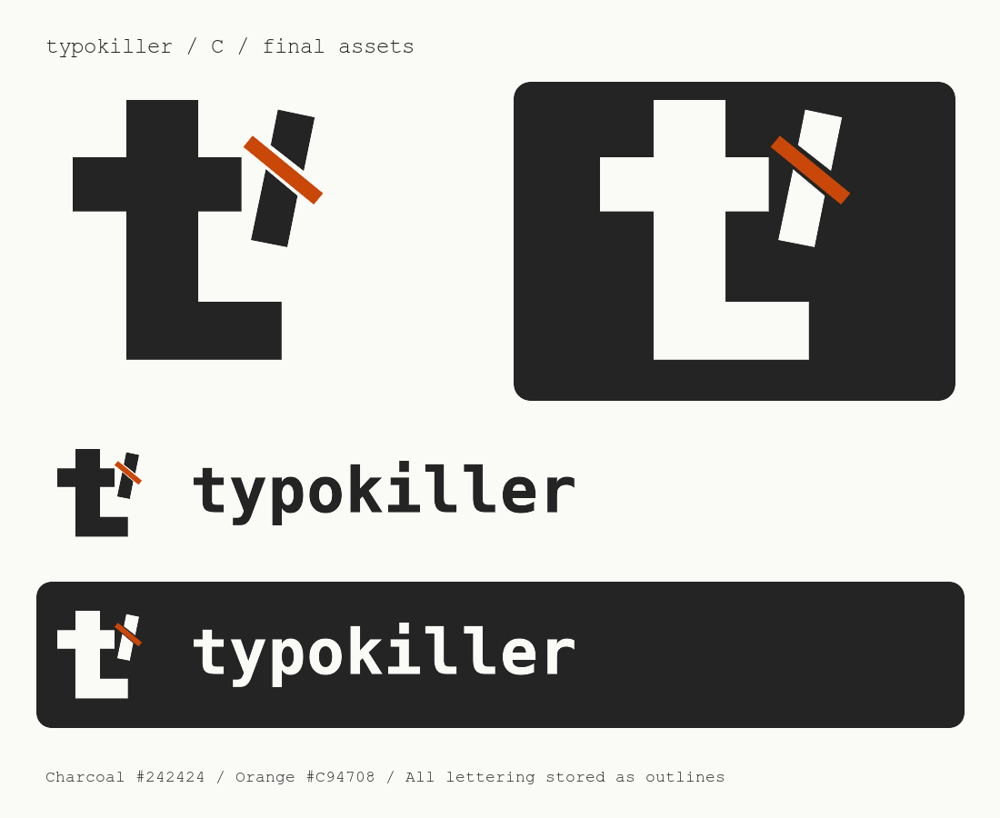

# typokiller logo

The final logo follows concept C: a square lowercase t beside a crossed-out stroke.
The symbol and header use the same shapes. The name in the header is stored as
vector outlines, so it does not require an installed font.



## Files

| File | Use |
| --- | --- |
| `symbol-colour.svg` | Symbol on a light background |
| `header-colour.svg` | Symbol beside the name on a light background |
| `symbol-dark.svg`, `header-dark.svg` | White and orange on a dark background |
| `symbol-black.svg`, `header-black.svg` | Single-colour black |
| `symbol-white.svg`, `header-white.svg` | Single-colour white |
| Matching `.png` files | Transparent exports at twice the SVG dimensions |
| `app-icon.svg` | Symbol on a rounded charcoal square |
| `app-icon-180.png` | Apple touch icon |
| `app-icon-192.png`, `app-icon-512.png` | App icons |
| `favicon.svg`, `favicon.ico` | Browser icons; ICO includes 16, 32, 48 and 64 pixels |
| `preview.svg`, `preview.png` | Comparison sheet, with backgrounds |

SVG is preferred for webpages and print. The symbol SVG has a square canvas with
space around the mark. Header SVGs have a horizontal canvas with space around
both the symbol and the name. All symbol and header backgrounds are transparent.
The app icons include a charcoal background and transparent outer corners.

## Colours and spacing

- Charcoal: `#242424`
- Orange: `#C94708`
- White for dark backgrounds: `#FAFAF7`

Keep at least one main vertical stroke's width of empty space around the visible
logo when placing it next to other content. Use the symbol below a header height
of 32 CSS pixels. At very small icon sizes the correction detail becomes less
distinct; the square t remains the main shape.

For a webpage header:

```html
<a href="/" aria-label="typokiller home">
  
</a>
```

Copy the chosen files into the site's served assets directory and adjust the
URL. Use `header-dark.svg` for a dark header.

## Rebuild

Run from the repository root on macOS, with Swift and ImageMagick installed:

```sh
swift -module-cache-path /private/tmp/typokiller-swift-cache assets/branding/build.swift
```

The script defines the symbol geometry, converts Menlo Bold lettering to paths
through CoreText, writes SVGs, and exports PNGs and ICO. The exported files have
no font dependency. The original concept previews remain in `output/branding/`.
